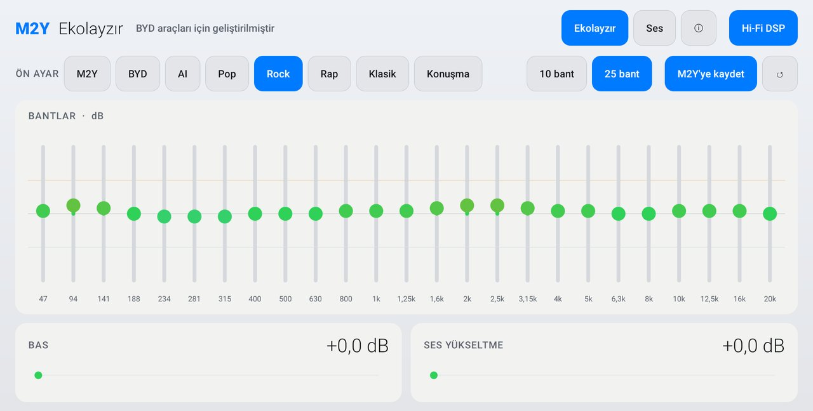
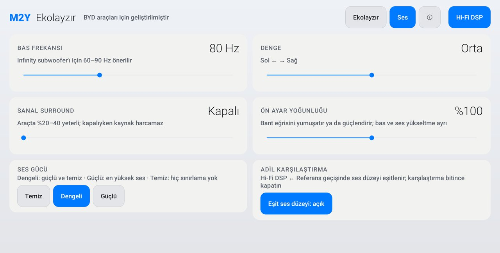

<p align="center"></p>
<h1 align="center">M2Y EQ</h1>
<p align="center"><b>A system-wide 25-band equalizer for the BYD multimedia screen, tuned for the Infinity sound system.</b><br><sub>BYD multimedya ekranı için Infinity ses sistemine göre ayarlanmış, tüm sisteme uygulanan 25 bantlı ekolayzır · Системный 25-полосный эквалайзер для мультимедийного экрана BYD, настроенный под аудиосистему Infinity</sub></p>
<p align="center">
  <a href="https://github.com/mehmetmesut/byd-m2y-eq/releases/latest"></a>
  <a href="https://github.com/mehmetmesut/byd-m2y-eq/releases"></a>
  
  
  
  
</p>
<p align="center">
  <a href="https://github.com/mehmetmesut/byd-m2y-eq/releases/download/1.25.07.68.1/M2YEQ_1.25.07.68.1.apk"><b>⬇ Download APK (128 KB)</b></a> ·
  <a href="https://byd.mehmetmesut.com">byd.mehmetmesut.com</a> ·
  <a href="https://github.com/mehmetmesut/byd-m2y">⭐ All M2Y apps for BYD</a>
</p>
<p align="center"> </p>

<details open>
<summary><b>🇬🇧 English</b></summary>

### Why this app

I built M2Y EQ first for **my own BYD SEAL U DM-i**. The head unit has no user equalizer beyond basic tone controls, and the store equalizers did not fit the car: ads, analytics, Google Play licensing that does not work without Google services, and heavy processing. Then I made it installable and usable on **BYD multimedia screens (DiLink)** and share it **free, without ads, without tracking**. It is a dependency-free Kotlin app of 128 KB, built to use **as little of the head unit's CPU, RAM and storage as possible**: fast to open, smooth to touch, stable.

### Highlights

- **25 bands that you can really hear.** Bands are aligned to the audio engine's real FFT bins, so moving a slider changes the sound instead of a number.
- **Tuned for this cabin.** Presets are written for the Infinity system in a closed SUV cabin (boot subwoofer, door woofers, centre speaker, tweeters).
- **One effect, whole system.** A single `DynamicsProcessing` instance on the global output mix, so every app that plays sound is equalized.
- **Fair A/B.** An equal-level mode and a Reference switch let you judge a preset without the "louder sounds better" trap.
- **Stays out of calls.** During phone, VoIP and CarPlay calls the effect removes itself, so the hands-free echo canceller sees the plain signal.
- **Free and private.** No ads, no tracking, no internet permission, GPL-3.0 source.

### Features

- **10 or 25 bands**, ±12 dB per band, aligned to the engine's real FFT bins (20 ms frames, 46.9 Hz bins at 48 kHz: one band per bin up to 281 Hz, 1/3 octave above), so every band is audible. Colour gradient (green → orange → red for boost, light blue → grey → purple for cut) and a ±6 dB safe-range guide; values beyond the safe range are shown in orange.
- **Presets:** M2Y (your own, editable), BYD (reference, flat), AI (gentle ±1.5 dB cabin correction), Pop, Rock, Rap, Classical, Speech. The presets avoid boosting 250–315 Hz (door-panel boxiness) and keep 4–5 kHz within +0.5 dB (A-pillar tweeters and windscreen glare).
- **Save to M2Y** keeps every setting (bands, bass, loudness, bass frequency, balance, surround, sound strength, intensity) and lights up only when something changed; **↺** returns M2Y to its factory values.
- **Sound strength:** Clean (preamp = largest boost + 2 dB, no limiting, quietest), Balanced (default: the first 3 dB of boost pass, the limiter catches peaks) or Strong (no preamp, as loud as other EQ apps); a **−1 dB limiter** always holds.
- **Preset intensity** 0–200 % scales the curve; **bass and loudness up to +15 dB**.
- **Fair comparison:** equal-level mode takes back the curve's average gain (90 Hz – 8 kHz) so presets can be judged without the louder-sounds-better trap.
- **Sound tab:** bass frequency (40–150 Hz, default 80 Hz; 60–90 Hz recommended for the subwoofer), left/right balance, optional virtual surround (the effect is only created when switched on, and dropped again if the output does not support it).
- **Hi-Fi DSP / Reference switch:** Reference removes every effect from the audio path for a true A/B; the factory Infinity chain then receives the stream untouched.
- **Call handling:** during phone, VoIP and CarPlay calls the EQ steps aside and returns when the call ends. The call state is also polled every 2 seconds because Android 10 has no audio-mode listener and modem or Bluetooth hands-free calls raise no playback event. The wake-word and voice-assistant capture is deliberately ignored, otherwise music would stay unprocessed most of the time.
- **Short fades** (about 40 ms) on preset changes, so there are no clicks.
- **Crash-safe engine:** if the audio server restarts or an effect is lost, the broken instance is dropped and rebuilt on the next apply instead of crash-looping the boot-time service. All effect work runs on one background thread.
- **Player integration:** music players can open M2Y EQ from their own "equalizer" button (`DISPLAY_AUDIO_EFFECT_CONTROL_PANEL`). If the platform ever refuses the global mix, the service follows individual player sessions instead.
- **Runs after reboot** through a foreground service with a minimum-importance notification that shows the current state; settings are re-applied after boot and after an app update.

### Built for the head unit

| Head unit fact | Design decision |
|---|---|
| Android 10 (API 29), arm64, no Google services | Pure Android audio effects, no libraries, no network permission |
| Infinity system, 10 speakers including a boot subwoofer, SUV cabin | Presets measured against this cabin; bass shelf 40–150 Hz (60–90 Hz recommended for the subwoofer) |
| Qualcomm SM6125, must never stutter | One `DynamicsProcessing` instance on the global mix (session 0); only parameters change, effects are never rebuilt; work on a background thread |
| Android 10 `DynamicsProcessing` works on FFT bins (46.9 Hz at 48 kHz with 20 ms frames) | 25 bands aligned to those bins, so every band owns at least one bin; about 21 ms latency at the same CPU cost |
| Hands-free calls through the car | During phone, VoIP and CarPlay calls the effect removes itself, so the echo canceller sees the plain signal |
| Audio server can restart or change route | Lost effects are detected and rebuilt on the next apply; no crash loop at boot |
| 1920×1080 landscape, 240 dpi touch screen | 56 dp touch targets, large numerals, day and night themes, forced landscape |
| No Google services, limited storage | 128 KB APK, no ads, no analytics, no Play licensing |

### Install

Head unit with wireless ADB enabled:

```
adb connect <car-ip>:5555
adb install -r M2YEQ_1.25.07.68.1.apk
```

- **Windows one-click installer:** https://byd.mehmetmesut.com/m2y-kurulum.cmd asks for the car's IP, downloads Google's platform-tools if missing, downloads the chosen apps, verifies SHA-256 and installs.
- **Direct install from the car's browser** only works on head units whose **stock BYD package installer has been unlocked** (the stock one blocks third-party APKs with a "driving safety" notice). The project does not distribute BYD files.
- After installing, the SealNav/stock launcher may need a restart to show a new icon.
- All M2Y APKs are signed with the same M2Y key, so updates install over the previous version and keep your settings.
- Checksums and all downloads: [byd.mehmetmesut.com](https://byd.mehmetmesut.com) · releases: [GitHub Releases](https://github.com/mehmetmesut/byd-m2y-eq/releases)

**First run:** open M2Y EQ once. Then allow it in the BYD **Auto-start** list (Turkish UI: *Otomatik Başlatma*) so the effect returns after every reboot.

### Privacy and permissions

| Permission | Why |
|---|---|
| `MODIFY_AUDIO_SETTINGS` | Create and control the audio effects (equalizer, limiter, optional virtual surround) |
| `FOREGROUND_SERVICE` | Keep the effect service alive while the car is on; it shows one low-priority notification |
| `RECEIVE_BOOT_COMPLETED` | Re-apply your settings after the head unit boots or the app is updated |

There is **no internet permission**. M2Y EQ never collects, stores or sends personal data, never records audio and has no analytics or ads. Your settings stay in the app's private storage on the head unit.

### Compatibility

Designed and tested on the BYD SEAL U DM-i (DiLink 3.0). Other BYD models with an Android 10+ arm64 multimedia screen are expected to work but are not tested.

Measured target: BYD DiLink 3.0 · Android 10 (API 29) · no Google services · Qualcomm SM6125 (8 cores, 4×1.8 + 4×2.0 GHz), Adreno 610 · 8 GB RAM · arm64-v8a · 1920×1080 landscape touch screen, 240 dpi, 60 Hz.

### Build from source

```
./gradlew test assembleRelease   # JDK 21, Android SDK
```

Kotlin, no third-party libraries; `minSdk` 28 (needed for `DynamicsProcessing`), `targetSdk` 29 on purpose (single device, Android 10). Unit tests cover the equalizer model (layouts, presets, headroom, level matching). Signing reads a properties file outside the repository (`m2y.signingProps` in `local.properties`).

### Closing words

I built these apps first for my own BYD SEAL U DM-i because the store apps did not fit the car. Then I made them installable on BYD multimedia screens and I share them free, without ads and without tracking, written to be gentle on the head unit's CPU, RAM and storage. If M2Y EQ makes your drive sound better, I would be glad if you give the hub a ⭐: [github.com/mehmetmesut/byd-m2y](https://github.com/mehmetmesut/byd-m2y).

**Yeşil Dönüşüm Mühendisi - M2Y**

</details>

<details>
<summary><b>🇹🇷 Türkçe</b></summary>

### Bu uygulama neden var

M2Y EQ'yu önce **kendi BYD SEAL U DM-i aracım** için yazdım. Multimedya ekranında temel ton ayarları dışında kullanıcıya açık bir ekolayzır yok; mağazadaki ekolayzırlar da araca uymadı: reklam, analitik, Google hizmetleri olmadan çalışmayan Google Play lisanslaması ve ağır işlemci yükü. Sonra uygulamayı **BYD multimedya ekranlarında (DiLink)** kurulup kullanılabilir hale getirdim ve **ücretsiz, reklamsız, izlemesiz** paylaşıyorum. 128 KB'lık, bağımlılıksız bir Kotlin uygulaması; **ekranın işlemcisini, belleğini ve depolamasını olabildiğince az kullanacak** şekilde, hızlı açılacak, dokunuşa gecikmesiz yanıt verecek ve kararlı çalışacak biçimde yazıldı.

### Öne çıkanlar

- **Gerçekten duyulan 25 bant.** Bantlar ses motorunun gerçek FFT kutularına hizalıdır; kaydırıcıyı oynattığınızda yalnız bir sayı değil, ses de değişir.
- **Bu kabine göre ayarlı.** Ön ayarlar, kapalı bir SUV kabininde Infinity sistemi (bagaj subwoofer'ı, kapı woofer'ları, orta hoparlör, tweeter'lar) için yazıldı.
- **Tek efekt, tüm sistem.** Genel çıkış karışımında tek bir `DynamicsProcessing` örneği çalışır; ses çalan her uygulama ekolayzırdan geçer.
- **Adil A/B.** Eşit ses düzeyi modu ve Referans anahtarı, "yüksek olan iyi gelir" yanılgısına düşmeden ön ayar karşılaştırmanızı sağlar.
- **Görüşmeye karışmaz.** Telefon, VoIP ve CarPlay görüşmelerinde efekt kendini kaldırır; ahizesiz eko giderici düz sinyali görür.
- **Ücretsiz ve gizli.** Reklam yok, izleme yok, internet izni yok, kaynak kodu GPL-3.0.

### Özellikler

- **10 veya 25 bant**, bant başına ±12 dB; bantlar motorun gerçek FFT kutularına hizalıdır (20 ms çerçeve, 48 kHz'de 46,9 Hz'lik kutular: 281 Hz'e kadar kutu başına bir bant, üstünde 1/3 oktav), böylece her bant duyulur. Renk gradyanı (yükseltme için yeşil → turuncu → kırmızı, kısma için açık mavi → gri → mor) ve ±6 dB güvenli aralık kılavuzu; güvenli aralığın dışındaki değerler turuncu gösterilir.
- **Ön ayarlar:** M2Y (kendi ayarınız, düzenlenebilir), BYD (referans, düz), AI (hafif ±1,5 dB kabin düzeltmesi), Pop, Rock, Rap, Klasik, Konuşma. Ön ayarlar 250–315 Hz'i yükseltmez (kapı panelinin çınlaması) ve 4–5 kHz'i +0,5 dB içinde tutar (A sütunundaki tweeter'lar ve ön cam parlaması).
- **M2Y'ye kaydet** tüm ayarları saklar (bantlar, bas, ses yükseltme, bas frekansı, denge, surround, ses gücü, yoğunluk) ve yalnız bir değişiklik varken etkinleşir; **↺** M2Y'yi fabrika değerlerine döndürür.
- **Ses gücü:** Temiz (ön kazanç = en büyük yükseltme + 2 dB, sınırlama yok, en sessiz), Dengeli (varsayılan: yükseltmenin ilk 3 dB'si geçer, tepeleri sınırlayıcı yakalar) veya Güçlü (ön kazanç yok, diğer EQ uygulamaları kadar yüksek); **−1 dB sınırlayıcı** her zaman devrededir.
- **Ön ayar yoğunluğu** %0–200 eğriyi ölçekler; **bas ve ses yükseltme +15 dB'e kadar**.
- **Adil karşılaştırma:** eşit ses düzeyi modu eğrinin ortalama kazancını (90 Hz – 8 kHz) geri alır; ön ayarlar "yüksek olan iyi gelir" yanılgısı olmadan karşılaştırılır.
- **Ses sekmesi:** bas frekansı (40–150 Hz, varsayılan 80 Hz; subwoofer için 60–90 Hz önerilir), sol/sağ denge, isteğe bağlı sanal surround (efekt yalnız açıldığında oluşturulur; çıkış desteklemiyorsa yeniden bırakılır).
- **Hi-Fi DSP / Referans anahtarı:** Referans, ses yolundan her efekti kaldırır, gerçek bir A/B sağlar; fabrika Infinity zinciri akışı değişmeden alır.
- **Görüşme yönetimi:** telefon, VoIP ve CarPlay görüşmelerinde EQ kenara çekilir, görüşme bitince geri döner. Android 10'da ses modu dinleyicisi olmadığından ve modem ya da Bluetooth ahizesiz görüşmeler oynatma olayı üretmediğinden görüşme durumu 2 saniyede bir de yoklanır. Uyandırma sözcüğü ve sesli asistan yakalaması bilerek yok sayılır; yoksa müzik çoğu zaman işlenmeden kalırdı.
- **Kısa geçişler** (yaklaşık 40 ms): ön ayar değişince tıkırtı olmaz.
- **Çökmeye dayanıklı motor:** ses sunucusu yeniden başlarsa ya da bir efekt kaybolursa bozuk örnek bırakılır ve sonraki uygulamada yeniden kurulur; açılışta çalışan servis çökme döngüsüne girmez. Tüm efekt işleri tek bir arka plan iş parçacığında yürür.
- **Oynatıcı bütünleşmesi:** müzik oynatıcıları kendi "ekolayzır" düğmesinden M2Y EQ'yu açabilir (`DISPLAY_AUDIO_EFFECT_CONTROL_PANEL`). Platform genel karışımı reddederse servis tek tek oynatıcı oturumlarını izler.
- **Yeniden başlatmadan sonra çalışır:** durumu gösteren, en düşük önemde bir bildirimi olan ön plan servisi sayesinde; ayarlar açılışta ve uygulama güncellemesinden sonra yeniden uygulanır.

### Ekran için tasarlandı

| Multimedya ekranı gerçeği | Tasarım kararı |
|---|---|
| Android 10 (API 29), arm64, Google hizmeti yok | Yalnız Android ses efektleri, kütüphane yok, ağ izni yok |
| Infinity sistemi, bagaj subwoofer'ı dahil 10 hoparlör, SUV kabini | Ön ayarlar bu kabine göre ölçüldü; bas rafı 40–150 Hz (subwoofer için 60–90 Hz önerilir) |
| Qualcomm SM6125, asla takılmamalı | Genel karışımda (oturum 0) tek `DynamicsProcessing` örneği; yalnız parametreler değişir, efektler yeniden kurulmaz; iş arka plan iş parçacığında |
| Android 10 `DynamicsProcessing` FFT kutularıyla çalışır (20 ms çerçevede 48 kHz'de 46,9 Hz) | 25 bant bu kutulara hizalı, her bant en az bir kutuya sahip; aynı işlemci maliyetiyle yaklaşık 21 ms gecikme |
| Araç üzerinden ahizesiz görüşme | Telefon, VoIP ve CarPlay görüşmelerinde efekt kendini kaldırır; eko giderici düz sinyali görür |
| Ses sunucusu yeniden başlayabilir ya da yol değiştirebilir | Kaybolan efektler algılanır ve sonraki uygulamada yeniden kurulur; açılışta çökme döngüsü yok |
| 1920×1080 yatay, 240 dpi dokunmatik ekran | 56 dp dokunma hedefleri, büyük rakamlar, gündüz ve gece temaları, zorunlu yatay yön |
| Google hizmeti yok, sınırlı depolama | 128 KB APK, reklam yok, analitik yok, Play lisanslaması yok |

### Kurulum

Kablosuz ADB açık multimedya ekranı:

```
adb connect <araç-ip>:5555
adb install -r M2YEQ_1.25.07.68.1.apk
```

- **Windows tek tıkla kurulum:** https://byd.mehmetmesut.com/m2y-kurulum.cmd aracın IP adresini sorar, yoksa Google platform-tools'u indirir, seçtiğiniz uygulamaları indirir, SHA-256 doğrulaması yapar ve kurar.
- **Aracın tarayıcısından doğrudan kurulum** yalnızca **BYD'nin kendi paket yükleyicisinin kilidi açılmış** multimedya ekranlarında çalışır (orijinal yükleyici üçüncü taraf APK'leri "sürüş güvenliği" uyarısıyla engeller). Proje BYD dosyası dağıtmaz.
- Kurulumdan sonra yeni simgenin görünmesi için SealNav/orijinal başlatıcının yeniden başlatılması gerekebilir.
- Tüm M2Y APK'leri aynı M2Y anahtarıyla imzalıdır; güncellemeler öncekinin üzerine kurulur ve ayarlarınız korunur.
- Sağlama toplamları ve tüm indirmeler: [byd.mehmetmesut.com](https://byd.mehmetmesut.com) · sürümler: [GitHub Releases](https://github.com/mehmetmesut/byd-m2y-eq/releases)

**İlk çalıştırma:** M2Y EQ'yu bir kez açın. Ardından efektin her yeniden başlatmadan sonra geri gelmesi için BYD **Otomatik Başlatma** listesinde izin verin.

### Gizlilik ve izinler

| İzin | Neden |
|---|---|
| `MODIFY_AUDIO_SETTINGS` | Ses efektlerini (ekolayzır, sınırlayıcı, isteğe bağlı sanal surround) oluşturmak ve denetlemek |
| `FOREGROUND_SERVICE` | Araç açıkken efekt servisini canlı tutmak; tek bir düşük öncelikli bildirim gösterir |
| `RECEIVE_BOOT_COMPLETED` | Multimedya ekranı açıldığında ya da uygulama güncellendiğinde ayarlarınızı yeniden uygulamak |

**İnternet izni yoktur.** M2Y EQ kişisel veri toplamaz, saklamaz ve göndermez; ses kaydetmez; analitik ya da reklam içermez. Ayarlarınız multimedya ekranında uygulamanın özel depolamasında kalır.

### Uyumluluk

BYD SEAL U DM-i (DiLink 3.0) üzerinde tasarlandı ve denendi. Android 10+ arm64 multimedya ekranlı diğer BYD modellerinde de çalışması beklenir, ancak denenmemiştir.

Ölçülen hedef: BYD DiLink 3.0 · Android 10 (API 29) · Google hizmeti yok · Qualcomm SM6125 (8 çekirdek, 4×1,8 + 4×2,0 GHz), Adreno 610 · 8 GB RAM · arm64-v8a · 1920×1080 yatay dokunmatik ekran, 240 dpi, 60 Hz.

### Kaynaktan derleme

```
./gradlew test assembleRelease   # JDK 21, Android SDK
```

Kotlin, üçüncü taraf kütüphane yok; `minSdk` 28 (`DynamicsProcessing` için gerekli), `targetSdk` 29 bilerek (tek cihaz, Android 10). Birim testleri ekolayzır modelini (yerleşimler, ön ayarlar, üst boşluk, düzey eşitleme) kapsar. İmzalama, depo dışındaki bir özellik dosyasını okur (`local.properties` içinde `m2y.signingProps`).

### Kapanış

Bu uygulamaları önce, mağaza uygulamaları araca uymadığı için kendi BYD SEAL U DM-i'm için yazdım. Sonra BYD multimedya ekranlarında kurulabilir hale getirdim ve ücretsiz, reklamsız, izlemesiz; ekranın işlemcisine, belleğine ve depolamasına yük bindirmeyecek biçimde paylaşıyorum. M2Y EQ aracınızın sesini güzelleştirdiyse merkez sayfaya bir ⭐ bırakmanıza sevinirim: [github.com/mehmetmesut/byd-m2y](https://github.com/mehmetmesut/byd-m2y).

**Yeşil Dönüşüm Mühendisi - M2Y**

</details>

<details>
<summary><b>🇷🇺 Русский</b></summary>

### Зачем это приложение

Сначала я сделал M2Y EQ для **собственного BYD SEAL U DM-i**. В мультимедийной системе нет пользовательского эквалайзера, кроме базовых регуляторов тембра, а эквалайзеры из магазинов не подошли автомобилю: реклама, аналитика, лицензирование Google Play, которое не работает без сервисов Google, и высокая нагрузка на процессор. Затем я сделал так, чтобы приложение можно было установить и использовать на **мультимедийных экранах BYD (DiLink)**, и раздаю его **бесплатно, без рекламы, без слежки**. Это приложение на Kotlin весом 128 КБ без сторонних библиотек; оно написано так, чтобы **занимать как можно меньше процессора, оперативной памяти и места на накопителе головного устройства**: быстро запускаться, мгновенно реагировать на касание и работать стабильно.

### Главное

- **25 полос, которые действительно слышно.** Полосы выровнены по реальным FFT-бинам аудиодвижка, поэтому ползунок меняет звук, а не только число.
- **Настроено под этот салон.** Пресеты написаны для системы Infinity в закрытом салоне внедорожника (сабвуфер в багажнике, дверные низкочастотные динамики, центральный динамик, твитеры).
- **Один эффект на всю систему.** Один экземпляр `DynamicsProcessing` на общем выходном микшере, поэтому эквализация действует на любое приложение со звуком.
- **Честное A/B-сравнение.** Режим равной громкости и переключатель «Референс» позволяют оценивать пресет без ловушки «громче значит лучше».
- **Не мешает разговорам.** Во время телефонных, VoIP- и CarPlay-звонков эффект сам отключается, и эхоподавитель громкой связи получает чистый сигнал.
- **Бесплатно и приватно.** Без рекламы, без слежки, без разрешения на интернет, исходный код под GPL-3.0.

### Возможности

- **10 или 25 полос**, ±12 дБ на полосу; полосы выровнены по реальным FFT-бинам движка (кадры по 20 мс, бины по 46,9 Гц при 48 кГц: до 281 Гц одна полоса на бин, выше — 1/3 октавы), поэтому каждая полоса слышна. Цветовой градиент (подъём: зелёный → оранжевый → красный, срез: голубой → серый → фиолетовый) и ориентир безопасного диапазона ±6 дБ; значения за его пределами показываются оранжевым.
- **Пресеты:** M2Y (ваш собственный, редактируемый), BYD (референс, плоский), AI (мягкая коррекция салона ±1,5 дБ), Pop, Rock, Rap, «Классика», «Речь». Пресеты не поднимают 250–315 Гц (гулкость дверных панелей) и держат 4–5 кГц в пределах +0,5 дБ (твитеры в стойках А и блики от лобового стекла).
- **«Сохранить в M2Y»** запоминает все настройки (полосы, бас, громкость, частоту баса, баланс, окружение, силу звука, интенсивность) и подсвечивается только при наличии изменений; **↺** возвращает M2Y к заводским значениям.
- **Сила звука:** «Чистая» (предусиление = наибольший подъём + 2 дБ, без ограничения, тише всего), «Сбалансированная» (по умолчанию: первые 3 дБ подъёма проходят, пики ловит ограничитель) или «Сильная» (без предусиления, так же громко, как другие эквалайзеры); **ограничитель −1 дБ** действует всегда.
- **Интенсивность пресета** 0–200 % масштабирует кривую; **бас и громкость до +15 дБ**.
- **Честное сравнение:** режим равной громкости возвращает средний прирост кривой (90 Гц – 8 кГц), поэтому пресеты можно сравнивать без ловушки «громче значит лучше».
- **Вкладка «Звук»:** частота баса (40–150 Гц, по умолчанию 80 Гц; для сабвуфера рекомендуется 60–90 Гц), баланс лево/право, необязательное виртуальное окружение (эффект создаётся только при включении и снова удаляется, если выход его не поддерживает).
- **Переключатель Hi-Fi DSP / «Референс»:** «Референс» убирает все эффекты из аудиотракта для настоящего A/B; заводская цепочка Infinity получает поток без изменений.
- **Обработка звонков:** во время телефонных, VoIP- и CarPlay-звонков эквалайзер отступает и возвращается после завершения звонка. Состояние звонка дополнительно опрашивается каждые 2 секунды: в Android 10 нет слушателя аудиорежима, а звонки громкой связи через модем или Bluetooth не порождают события воспроизведения. Захват слова активации и голосового ассистента намеренно игнорируется, иначе музыка большую часть времени оставалась бы необработанной.
- **Короткие плавные переходы** (около 40 мс) при смене пресета, без щелчков.
- **Устойчивый к сбоям движок:** если аудиосервер перезапустился или эффект потерян, повреждённый экземпляр отбрасывается и пересоздаётся при следующем применении, вместо цикла падений службы, запускаемой при загрузке. Вся работа с эффектами идёт в одном фоновом потоке.
- **Интеграция с плеерами:** музыкальные плееры могут открыть M2Y EQ собственной кнопкой «эквалайзер» (`DISPLAY_AUDIO_EFFECT_CONTROL_PANEL`). Если платформа откажет в общем микшере, служба переключается на сессии отдельных плееров.
- **Работает после перезагрузки:** через фоновую службу переднего плана с уведомлением минимальной важности, показывающим текущее состояние; настройки применяются заново после загрузки и после обновления приложения.

### Создано для головного устройства

| Факт о головном устройстве | Решение |
|---|---|
| Android 10 (API 29), arm64, без сервисов Google | Только штатные аудиоэффекты Android, без библиотек, без сетевого разрешения |
| Система Infinity, 10 динамиков, включая сабвуфер в багажнике, салон внедорожника | Пресеты выверены под этот салон; полка баса 40–150 Гц (для сабвуфера рекомендуется 60–90 Гц) |
| Qualcomm SM6125, никаких подтормаживаний | Один экземпляр `DynamicsProcessing` на общем микшере (сессия 0); меняются только параметры, эффекты не пересоздаются; работа в фоновом потоке |
| `DynamicsProcessing` в Android 10 работает с FFT-бинами (46,9 Гц при 48 кГц и кадрах 20 мс) | 25 полос выровнены по этим бинам, у каждой полосы не менее одного бина; задержка около 21 мс при той же нагрузке на процессор |
| Громкая связь через автомобиль | Во время телефонных, VoIP- и CarPlay-звонков эффект сам отключается, эхоподавитель получает чистый сигнал |
| Аудиосервер может перезапуститься или сменить маршрут | Потерянные эффекты обнаруживаются и пересоздаются при следующем применении; нет цикла падений при загрузке |
| Сенсорный экран 1920×1080, альбомный, 240 dpi | Цели касания 56 dp, крупные цифры, дневная и ночная темы, принудительная альбомная ориентация |
| Нет сервисов Google, мало места | APK 128 КБ, без рекламы, без аналитики, без лицензирования Play |

### Установка

Головное устройство с включённым беспроводным ADB:

```
adb connect <ip-автомобиля>:5555
adb install -r M2YEQ_1.25.07.68.1.apk
```

- **Установщик для Windows в один клик:** https://byd.mehmetmesut.com/m2y-kurulum.cmd спрашивает IP автомобиля, при необходимости скачивает platform-tools от Google, скачивает выбранные приложения, проверяет SHA-256 и устанавливает их.
- **Прямая установка из браузера автомобиля** работает только на устройствах, у которых **разблокирован штатный установщик пакетов BYD** (штатный блокирует сторонние APK с уведомлением о «безопасности движения»). Проект не распространяет файлы BYD.
- После установки может потребоваться перезапуск SealNav/штатного лаунчера, чтобы появился новый значок.
- Все APK M2Y подписаны одним и тем же ключом M2Y, поэтому обновления ставятся поверх предыдущей версии и сохраняют настройки.
- Контрольные суммы и все загрузки: [byd.mehmetmesut.com](https://byd.mehmetmesut.com) · релизы: [GitHub Releases](https://github.com/mehmetmesut/byd-m2y-eq/releases)

**Первый запуск:** откройте M2Y EQ один раз. Затем разрешите его в списке BYD **«Автозапуск»** (в турецком интерфейсе: *Otomatik Başlatma*), чтобы эффект возвращался после каждой перезагрузки.

### Конфиденциальность и разрешения

| Разрешение | Зачем |
|---|---|
| `MODIFY_AUDIO_SETTINGS` | Создавать аудиоэффекты (эквалайзер, ограничитель, необязательное виртуальное окружение) и управлять ими |
| `FOREGROUND_SERVICE` | Держать службу эффекта активной, пока автомобиль включён; показывает одно уведомление низкого приоритета |
| `RECEIVE_BOOT_COMPLETED` | Заново применять ваши настройки после загрузки головного устройства или обновления приложения |

**Разрешения на интернет нет.** M2Y EQ не собирает, не хранит и не отправляет личные данные, не записывает звук, не содержит аналитики и рекламы. Ваши настройки остаются в закрытом хранилище приложения на головном устройстве.

### Совместимость

Разработано и проверено на BYD SEAL U DM-i (DiLink 3.0). Для других моделей BYD с мультимедийным экраном на Android 10+ (arm64) работа ожидается, но не проверялась.

Измеренная целевая платформа: BYD DiLink 3.0 · Android 10 (API 29) · без сервисов Google · Qualcomm SM6125 (8 ядер, 4×1,8 + 4×2,0 ГГц), Adreno 610 · 8 ГБ ОЗУ · arm64-v8a · сенсорный экран 1920×1080 в альбомной ориентации, 240 dpi, 60 Гц.

### Сборка из исходников

```
./gradlew test assembleRelease   # JDK 21, Android SDK
```

Kotlin, без сторонних библиотек; `minSdk` 28 (нужен для `DynamicsProcessing`), `targetSdk` 29 намеренно (одно устройство, Android 10). Модульные тесты покрывают модель эквалайзера (раскладки, пресеты, запас по уровню, выравнивание громкости). Подпись читает файл свойств вне репозитория (`m2y.signingProps` в `local.properties`).

### Вместо заключения

Эти приложения я сначала написал для собственного BYD SEAL U DM-i, потому что магазинные приложения не подошли автомобилю. Затем я сделал их устанавливаемыми на мультимедийные экраны BYD и раздаю бесплатно, без рекламы и без слежки, стараясь не нагружать процессор, память и накопитель головного устройства. Если M2Y EQ сделал звук в вашем автомобиле лучше, буду рад ⭐ на центральной странице: [github.com/mehmetmesut/byd-m2y](https://github.com/mehmetmesut/byd-m2y).

**Yeşil Dönüşüm Mühendisi - M2Y**

</details>

<hr>
<p align="center"><sub>GPL-3.0 · Source code and licence: <a href="LICENSE">LICENSE</a> · Not affiliated with BYD or Harman/Infinity; trademarks belong to their owners. · © 2026 Yeşil Dönüşüm Mühendisi - M2Y</sub></p>
